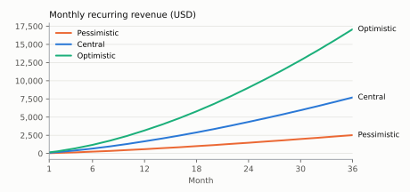
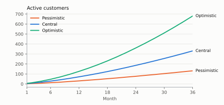
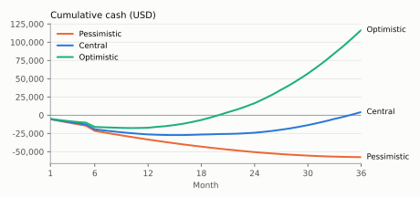

# Nhill subscriptions: financial and marketing study

*Français : [../fr/16-etude-financiere-abonnements.md](../fr/16-etude-financiere-abonnements.md)*

| | |
|---|---|
| Version | 1.0 — 27 October 2026 |
| Status | **recommendations subject to the product owner's approval**: no price is published on the website or loaded into the database |
| Method | public prices collected online on 26 and 27 October 2026 (§ 15), inspection of the Nhill 2.1 code, reproducible financial model (`marketing/tools/subscription_model.py`) |
| Legend | **V** verified data, with its source and date; **H** assumption to validate; calculations are made by the script, never by hand |
| Calculation currency | US dollar (USD); 1 EUR = 1.149 USD (0.87 EUR per USD, August 2026 reading) |

## 1. Executive summary

- **Recommended positioning**: Nhill is the all-in-one solution for freelancers, shops
  and SMEs that want to sell, take payments and follow their stock from the first day,
  with **one subscription per establishment** (not a licence per user) and support to
  get started. Against modular ERPs such as Odoo, the case is a quick start, everyday
  tools already connected and a predictable cost as the team grows.
- **Three plans** (Solo, Commerce, SME) plus a custom offer, built on the limits that
  already exist in the code (users, tills, warehouses). Proposed prices for **zone A**
  (low and lower-middle income countries, including the DRC): **$9, $25 and $59 a
  month**, 10 months paid for an annual subscription. A **zone B** (upper-middle and high
  income) at **$15, $39 and $89** should only open after the compliance work specific to
  each target country.
- **Break-even**: with a minimal team (founder, one onboarding agent, one sales agent)
  and the current infrastructure, about **99 active customers** are needed in zone A
  (64 in zone B).
- **36-month scenarios**: lasting operating break-even in **month 23** in the central
  scenario (331 active customers in month 36, annual recurring revenue of about $92,000),
  month 15 in the optimistic one, not reached in the pessimistic one. Maximum cash need:
  **$27,500** (central) to **$58,100** (pessimistic).
- **What decides**: the number of demos (45 a month by month 12 in the central
  scenario), churn (every extra point is costly) and the price customers actually
  accept, to be measured during the pilot before anything is published.
- **Multi-currency**: one reference price list in USD, CDF, EUR, XAF/XOF lists derived by
  a published, reviewed rule, the billing currency chosen at sign-up; no automatic card
  or Mobile Money payment is announced until the integration is tested in real
  conditions.

## 2. The product and its target segments

### 2.1 What exists in Nhill 2.1 (code inspected)

| Area | Available functions |
|---|---|
| Sales | quotes, orders, invoices, credit notes as PDF, partial payments, receivables per currency |
| Till (Nhill POS, Windows and Linux) | sessions, several payment methods per ticket, discounts and voids approved by a supervisor, blind cash count, variance, X and Z reports |
| Stock and purchasing | stock per warehouse, movements, threshold alerts, transfers, supplier purchases, expenses |
| Management | dashboard, PDF and CSV reports, tamper-proof activity log, roles per employee |
| Platform | Nhill Business on Windows, Linux and Android; English and French; ten currencies (USD, EUR, GBP, CHF, XAF, XOF, CDF, KES, RWF, ZAR); establishments isolated in the database |
| Subscriptions (Nhill Console) | plans with `max_users`, `max_registers`, `max_warehouses` limits, `multi_warehouse` option, audience (individual, company), prices **per duration (1, 3, 6, 12, 24, 36 months) and per currency**, promo codes, prorated credit when changing plan, 30-day trial (setting), 7-day grace period, read-only after suspension |
| Collecting subscriptions | manual payment instructions; Stripe (cards) and PayPal adapters **tested only against a local fake service**; Payoneer configured without an adapter |

Out of scope today (to keep in mind for price and competition): general ledger, till on
Android, sending documents directly by e-mail, connection to Mobile Money operators, tax
certification in any country (the DRC profile is a draft to be validated; the
international profile is generic).

### 2.2 Segments

| Segment | Main need | What Nhill brings | Natural plan |
|---|---|---|---|
| Freelancer, solopreneur (service provider, craftsperson, consultant, small seller) | quotes, invoices, payments, knowing who owes what | invoices in their name, attached payments, expenses, Android phone | Solo |
| Small business, shop (2 to 5 people, one or two tills) | reliable till, accurate stock, control of sales staff | till with variance, automatic stock, roles, log | Commerce |
| SME (6 to 15 people, several tills or warehouses) | remote control, several sites, reports for the accountant | several warehouses and tills, reports, exports | SME |
| Larger or multi-establishment business | specific needs | on quote, several establishments under one account | Custom |

DRC market data (market study, document 01): in a survey of 914 MSMEs, 51% use digital
tools, but only 19% of equipped MSMEs have stock management software, and cost is the
first barrier cited (54% of micro-enterprises). These figures guide the zone A price
level; they do not measure willingness to pay.

## 3. Market and competition

### 3.1 Economic context of the launch zone (DRC)

| Data | Value | Source (V) |
|---|---|---|
| World Bank classification (fiscal year 2027, 2025 gross national income per capita) | DRC and Rwanda: low income; Cameroon, Côte d'Ivoire, Senegal, Kenya, Nigeria, Congo-Brazzaville: lower-middle income; South Africa, Gabon: upper-middle income. Thresholds: low ≤ $1,175, lower-middle $1,176 to $4,635, upper-middle $4,636 to $14,375, high > $14,375 | Afridigest, 8 July 2026, from the World Bank |
| Preference for the dollar | "préférence pour le dollar" noted by the IMF; $13.0 billion of dollar deposits in the banking system | IMF, country report No. 26/2, January 2026 |
| Growth | real GDP: +5.6% in 2025, about +5.3% projected for 2026 | IMF, country report No. 26/2 (table 1; year alignment to check in the PDF) |
| Exchange rate | 1 USD = 2,264.0000 CDF (BCC official rate, 26/10/2026); 2,317.50 CDF (market, 23/10/2026), a 0.98% depreciation over a year | BCC (document 01, S3); Trading Economics |

Consequence: a USD reference price matches the target's habits; a CDF list is still
needed for those who pay in francs, with a review rule (§ 11).

### 3.2 Direct and indirect competitors

| Solution | Category | Pricing model | Strengths | Where Nhill stands out |
|---|---|---|---|---|
| Odoo | modular ERP | per user per month, price list per country; one free application | very broad coverage (accounting, CRM, point of sale, manufacturing…) | guided start, everyday tools already connected, price per establishment |
| Zoho Books, Zoho Inventory | online accounting and stock | per organisation, users included per tier; free plan under a revenue threshold | full accounting, low prices, local price lists (Kenya) | integrated till with controls, stock and counter sales in the same tool |
| QuickBooks Online | accounting | per company, users per tier | accounting, accountant ecosystem | price suited to small businesses in zone A, till included |
| Sage Accounting (Africa) | accounting | per company, paid options (multi-currency, advanced stock) | African presence, USD prices in Kenya and Nigeria | multi-currency and stock included, till |
| Loyverse, Square | point of sale | free till, paid options per store | free to start, hardware | quotes, invoices, receivables, purchases, multi-currency in the same tool |
| Dolibarr (DoliCloud), ERPNext (Frappe Cloud) | hosted open-source ERPs | per user (DoliCloud) or flat (ERPNext) | open source, broad | ease of use, support, till with controls |
| Notebook, spreadsheet, local till software | current alternatives | free or licence | familiar, no subscription | traceability, remote follow-up, several workstations |

Main threat: **free** offers (Odoo one application, Zoho Books free, Loyverse) at entry
level. Response: Nhill does not win the Solo segment on price alone but on the complete
tool (till + invoices + stock), simplicity and support; the Solo price must stay under
the $10 psychological threshold.

## 4. Price and feature comparison

Public prices, excluding tax, in USD unless stated. Odoo data comes from third-party
pages that reproduce odoo.com (the official page could not be read by our tools):
**check on odoo.com from the contracting country** before any communication.

| Solution and tier | Price collected | Users / limits | Till | Stock | Multi-currency | Source (date) |
|---|---|---|---|---|---|---|
| Odoo Standard, United States list | $24.90 per user per month in year 1, then $31.10 (annual); monthly +20 to 25% | per user | application included | yes | yes | ERP Research, July 2026; Cybrosys |
| Odoo Standard, "Sub-Saharan Africa" list | $8.95 per user per month (annual); Custom $13.60 | per user | yes | yes | yes | OEC.sh, verified 18 October 2026 |
| Odoo "One App Free" | $0 | one application, unlimited users, no Studio or multi-company | if the chosen application is point of sale | no (other application) | — | Cybrosys |
| Zoho Books (United States) | free (revenue < $50,000), Standard $15 (annual) / $20, Professional $40 / $50, Premium $60 / $70; extra user $2.50 / $3 | 1, 3, 5, 10 | no | from Professional | from Professional | zoho.com, 27/10/2026 |
| Zoho Books (Kenya) | Standard KSh 849 (≈ $6.54), Professional KSh 1,699 (≈ $13.08), Premium KSh 2,499 (≈ $19.24) a month, annual | 3, 5, 10 | no | from Professional | from Professional | zoho.com/ke, 27/10/2026; 1 USD = KSh 129.907 on 26/10/2026 |
| Zoho Inventory (United States, annual) | Standard $29, Premium $79, Plus $129, Enterprise $249; free: 50 orders | 3 to 10; 2 to 10 locations | no | yes | — | zoho.com, 27/10/2026 |
| QuickBooks Online (United States) | Simple Start $38, Essentials $85, Plus $140, Advanced $340 (−50% for three months on promotion) | 1, 3, 5, 25 | no | Plus | — | quickbooks.intuit.com, 27/10/2026 |
| Sage Accounting (Kenya, Nigeria) | Start $12.33, Standard $23.67 a month; options in South Africa: multi-currency R185, advanced inventory R465 a month | 1; 2 (up to 5) | no | option | option | sage.com/africa, 27/10/2026 |
| Loyverse | free till; employee management $25, advanced inventory $25 per store per month ($250 a year each) | per store | yes | essential free, advanced paid | — | loyverse.com, 27/10/2026 |
| Square (United States) | Free $0, Plus $49, Premium $149 per location per month; in-person payments 2.5% + $0.15 (Plus) | per location | yes | yes | — | Square press release, 6 October 2025 |
| DoliCloud (hosted Dolibarr) | Basic €14 per user per month; Premium €30 + €15 per user | per user | module | yes | yes | dolicloud.com, 27/10/2026 |
| ERPNext, Small Business plan (Frappe Cloud) | $50 a month, unlimited users | unlimited | yes | yes | yes | Frappe announcement, 14 August 2023 (old, to recheck) |

Monthly cost compared for three typical profiles, zone A (annual subscription brought
back to a month when the published price is annual):

| Profile | Nhill (proposed) | Odoo Standard, Sub-Saharan Africa list | Zoho Books Kenya | Loyverse with employees and advanced inventory |
|---|---|---|---|---|
| Freelancer, 1 user | Solo: $9 ($7.50 on annual) | $8.95 | free (under the threshold) or $6.54 | $0 (till only) to $50 |
| Shop, 5 users, 2 tills | Commerce: $25 ($20.83 on annual) | $44.75 (5 × $8.95) | $13.08 (no till) | $50 per store |
| SME, 15 users, 5 tills, 3 warehouses | SME: $59 ($49.17 on annual) | $134.25 (15 × $8.95) | $19.24 for 10 users (no till) | $150 for 3 stores |

Reading: Nhill is **more affordable than an ERP billed per user as soon as the team has
more than two or three people**, and stays close to entry prices on the market for a
freelancer. Accounting-only software costs less but does not cover the till; free tills
do not cover quotes, invoices and receivables.

## 5. Recommended business model

1. **Subscription per establishment**, with limits on users, tills and warehouses
   (existing mechanism); no licence per user.
2. **Monthly or annual payment**; annual gives two months (10 months paid). Quarterly
   (3 months, no discount) is offered in zone A, where cash cycles are short; 6, 24 and
   36-month durations exist in the code but are not recommended at launch.
3. **Free assisted trial** (eight-week pilot programme, then a 30-day trial): conversion
   happens on real use.
4. **One-off services invoiced separately** (extra training, complex data migration,
   installation outside Kinshasa): prices to be set after measuring the time spent
   during the pilot.
5. **No paid options at launch**: the code does not handle per-unit options; the limits
   are enough to tell the plans apart.
6. **Two price zones** based on an objective, public criterion (World Bank
   classification of the establishment's country), not on a currency conversion.

## 6. Proposed plans and prices

<!-- model:plans -->
| Plan | For whom | Users | POS tills | Warehouses | Monthly price, zone A | Annual, zone A (10 months) | Monthly price, zone B | Annual, zone B |
|---|---|---|---|---|---|---|---|---|
| Solo | freelancer, solopreneur | 1 | 1 | 1 | $9 | $90 | $15 | $150 |
| Commerce | small business, shop | 5 | 2 | 1 | $25 | $250 | $39 | $390 |
| SME | SME, several sites | 15 | 5 | 3 | $59 | $590 | $89 | $890 |
| Custom | beyond 15 users, 5 tills or 3 warehouses | on quote | on quote | on quote | on quote | on quote | on quote | on quote |
<!-- /model -->

Database mapping (to enter in Nhill Console **after approval**): `plans` (`code` solo,
commerce, pme; `max_users`, `max_registers`, `max_warehouses`, `features.multi_warehouse`
true for SME, `audience` individual for Solo) and `plan_prices` (durations 1, 3 and
12 months; one row per billing currency).

## 7. Rationale for each price

| Plan | Zone A price | Rationale |
|---|---|---|
| Solo | $9 a month | under the $10 threshold; level with the Odoo Sub-Saharan Africa list for one user ($8.95, annual) and Sage Start Kenya ($12.33); comfortably covers the cost to serve (§ 8.3); must stay a stepping stone to Commerce |
| Commerce | $25 a month | core plan: 5 users and 2 tills for about half the Odoo price for 5 users ($44.75) and half of Loyverse with employees and advanced inventory ($50 per store); easy-to-read round figure; the model's ARPA centres on this plan |
| SME | $59 a month | multi-warehouse and 15 users: less than half the Odoo price for 15 users ($134.25); gap with Commerce clear enough for the upgrade to follow a need (warehouses, tills) |
| Custom | on quote | beyond the limits, integration needs or specific support |
| Zone B | $15, $39 and $89 | same structure; well below QuickBooks ($38 to $140) and Odoo United States per user ($24.90 to $31.10 each), and about 55% more contribution per customer ($37.22 against $24.02) |

Tests to run during the pilot, before publication: a price-sensitivity questionnaire
(Van Westendorp: too expensive, expensive, cheap, too cheap) with each pilot customer,
and three different written proposals (Solo $7 / $9 / $12, Commerce $19 / $25 / $35)
followed through to signature. The price kept is the one that maximises revenue per
demo, not the signature rate alone.

## 8. Forecast budget and cost structure

### 8.1 Cost assumptions

<!-- model:hypotheses -->
| Assumption | Value | Type |
|---|---|---|
| Hetzner CX23 application server (2 vCPU, 4 GB, 40 GB) €5.99 + 20% backups | $8.26 / month | verified |
| Supabase Pro managed PostgreSQL (8 GB, daily backup kept 7 days) | $25 / month | verified |
| Encrypted off-site backups (Backblaze B2, $6.95/TB; first 10 GB free) | $1 / month | assumption |
| E-mail delivery (Amazon SES, $0.10 per 1,000 e-mails) | $1 / month | assumption |
| Domain name ($20 a year) | $1.67 / month | assumption |
| Windows installer signing (Azure Artifact Signing, $9.99 quoted, to be confirmed) | $9.99 / month | assumption |
| Tools: help desk, CRM, video calls, office suite | $45 / month | assumption |
| Accountant, legal and administrative fees | $150 / month | assumption |
| Mobile data, phone, team travel | $80 / month | assumption |
| Demo material, printing, small events | $150 / month | assumption |
| Founder pay (product, development) | $1,000 / month | assumption |
| Onboarding and support agent (1 per 150 active customers) | $500 / month | assumption |
| Active customers per support agent | 150 | assumption |
| Field sales agent, fixed pay (1 more above 12, then 24 new customers a month) | $400 / month | assumption |
| Sales bonus per new paying customer | $15 / new customer | assumption |
| Travel and material per new customer | $10 / new customer | assumption |
| Average collection fees (Mobile Money 2.5-3.2% via an aggregator, transfers, cards) | 3.5% | assumption |
| Share of new customers brought by a partner | 20.0% | assumption |
| Partner commission on the first year collected | 20.0% | assumption |
| Share of new customers from referrals (1 month free for the referrer) | 15.0% | assumption |
| Average discounts (promo codes, commercial gestures) | 5.0% | assumption |
| Active establishments per application server (no load test performed) | 250 | assumption |
| Active establishments above which the database moves to larger compute (+$15/month) | 500 | assumption |
<!-- /model -->

One-off expenses:

<!-- model:one_off -->
| Month | One-off expense | Amount | Type |
|---|---|---|---|
| M1 | Company set-up, legal and tax advice | $1,500 | assumption |
| M1 | Demo hardware (receipt printer, scanner, Android tablet) | $1,200 | assumption |
| M1 | Google Play developer account (one-time fee) | $25 | verified |
| M1 | Printed brand material, cards, banner | $500 | assumption |
| M6 | External penetration test before a wide roll-out | $5,000 | assumption |
<!-- /model -->

Sources of verified prices: Hetzner CX23 at €5.99 a month with IPv4 (August 2026
reading, after the 15 June 2026 price adjustment) and backups at 20% of the server price
(Hetzner documentation); Supabase Pro at $25 a month (8 GB database, daily backup kept
7 days, $10 compute credit); Backblaze B2 at $6.95 per TB per month; Amazon SES at
$0.10 per 1,000 e-mails; Google Play at $25 once. The Azure Artifact Signing price is not
shown on its page: $9.99 a month is the figure quoted on Microsoft's forum (October 2025),
**to be confirmed**. The starting size (2 vCPU, 4 GB, 40 GB) is the one in Nhill's
deployment guide.

### 8.2 Monthly costs of the central scenario

<!-- model:costs -->
| Item (central scenario) | Month 1 | Month 12 | Month 24 | Month 36 |
|---|---|---|---|---|
| Infrastructure and signing | $47 | $47 | $47 | $55 |
| Team | $1,900 | $1,900 | $2,800 | $3,300 |
| Tools, accountant, telecoms, fixed marketing | $425 | $425 | $425 | $425 |
| Variable acquisition (bonuses, travel, referrals) | $114 | $256 | $427 | $598 |
| Partner commissions | $4 | $67 | $127 | $188 |
| Collection fees | $14 | $66 | $165 | $286 |
| Total recurring costs | $2,504 | $2,761 | $3,991 | $4,853 |
| Monthly recurring revenue | $94 | $1,669 | $4,340 | $7,707 |
| Operating result | -$2,399 | -$1,085 | $361 | $2,870 |
<!-- /model -->

### 8.3 Cost to serve per customer

<!-- model:unit_costs -->
| Cost to serve per active customer per month (central) | Month 12 | Month 36 |
|---|---|---|
| Servers, database, backups, e-mail, signing | $0.66 | $0.17 |
| Support (agents) | $6.98 | $4.53 |
| Collection fees | $0.92 | $0.87 |
| Total | $8.56 | $5.57 |
| Average revenue per account (ARPA) | $23.31 | $23.29 |
<!-- /model -->

Infrastructure costs less than a dollar per customer per month; the cost to serve
depends mostly on support time. **Major unknown**: no load test has been run; the number
of establishments per server (250) is a cautious assumption to replace with a measurement
before 100 customers.

## 9. Break-even

Fixed costs of a typical month: founder, one onboarding agent, one sales agent,
infrastructure, tools, accountant, telecoms, fixed marketing. Contribution per customer:
ARPA of the central mix, after discounts, minus collection fees.

<!-- model:break_even -->
| Price zone | ARPA (central mix, after discounts) | Fixed costs of a typical month | Contribution per customer | Active customers to break even |
|---|---|---|---|---|
| A (launch) | $24.89 | $2,372 | $24.02 | 99 |
| B | $38.57 | $2,372 | $37.22 | 64 |
<!-- /model -->

Formula: customers needed = fixed costs ÷ (ARPA × (1 − collection fees)). Above 150
customers, a second onboarding agent (+$500) raises the threshold by about 21 customers
in zone A.

## 10. Financial scenarios over 36 months

Month 1 is the first month of sales after the pilot (date to be set). Parameters:

<!-- model:scenario_inputs -->
| Parameter | Pessimistic | Central | Optimistic |
|---|---|---|---|
| New paying customers in month 1 | 2 | 4 | 6 |
| Growth | +1 every 4 months | +1 every 2 months | +2 every 2 months |
| Monthly cap on new customers | 10 | 25 | 45 |
| Monthly churn | 5% | 3% | 2% |
| Solo / Commerce / SME split | 45 / 45 / 10% | 35 / 45 / 20% | 30 / 45 / 25% |
| Share of annual subscriptions | 25% | 35% | 45% |
<!-- /model -->

Results:

<!-- model:results -->
| Indicator | Pessimistic | Central | Optimistic |
|---|---|---|---|
| Active customers, month 12 | 31 | 72 | 126 |
| Active customers, month 24 | 77 | 186 | 361 |
| Active customers, month 36 | 132 | 331 | 681 |
| Monthly recurring revenue (MRR), month 12 | $586 | $1,669 | $3,163 |
| Monthly recurring revenue (MRR), month 24 | $1,471 | $4,340 | $9,055 |
| Monthly recurring revenue (MRR), month 36 | $2,517 | $7,707 | $17,087 |
| Annual recurring revenue (ARR), month 36 | $30,199 | $92,478 | $205,047 |
| Average revenue per account (ARPA), month 36 | $19 / month | $23 / month | $25 / month |
| Month of lasting operating break-even | not reached in 36 months | M23 | M15 |
| Maximum cash need (cumulative low point) | $58,126 in month 36 | $27,472 in month 15 | $17,789 in month 10 |
| Cumulative cash, month 36 | -$58,126 | $3,683 | $116,258 |
| Average acquisition cost (CAC) | $125 | $96 | $83 |
| Gross margin (collection, servers, support) | 48% | 72% | 78% |
| Customer lifetime value (LTV) | $182 | $556 | $978 |
| LTV / CAC | 1.4 | 5.8 | 11.8 |
| CAC payback | 13.8 months | 5.8 months | 4.2 months |
| Demos needed in month 12 | 20 | 45 | 80 |
<!-- /model -->







Sensitivity of the central scenario:

<!-- model:sensitivity -->
| Variant of the central scenario | Break-even month | Maximum cash need | Cumulative cash, month 36 |
|---|---|---|---|
| Central scenario as is | M23 | $27,472 | $3,683 |
| Prices −20% | M27 | $34,596 | -$21,378 |
| Prices +20% | M16 | $24,161 | $28,744 |
| Churn 4% a month | M24 | $28,034 | -$2,863 |
| Founder unpaid for 36 months | M13 | $14,690 | $39,683 |
| Self-hosted database (2nd CX23 instead of Supabase) | M23 | $27,221 | $4,286 |
<!-- /model -->

Reading: price and churn weigh the most; prices 20% lower push break-even back by four
months and leave cash negative in month 36. The founder's pay is the main short-term cash
lever. The database choice (Supabase or self-hosted server) changes the result little; it
is decided on reliability and operating time.

## 11. Multi-currency and international strategy

### 11.1 Three distinct notions

| Notion | Recommended rule | What exists in the code |
|---|---|---|
| Display currency | the currency of the written proposal and of the subscription screen is **the billing currency chosen**; the website shows no price | prices stored per currency in `plan_prices`; no conversion on display |
| Billing currency | chosen at sign-up among the published lists (USD everywhere; EUR; CDF in the DRC; XAF or XOF in the CEMAC and WAEMU zones; KES and RWF when those countries open); unchanged until renewal | a subscription order carries its currency; the payment provider declares the currencies it accepts |
| Conversion | never silent: an invoiced amount is not converted; non-USD lists are **derived** from the USD list by a published rule; internal reports consolidate in USD at the payment-date rate | lists entered in the console; platform reports per currency |

### 11.2 Rule for deriving price lists

Local price = USD price × reference rate, rounded to a round price (CDF 500; XAF/XOF 100;
€1; KSh 10). Reference rate: BCC for CDF, the fixed euro / CFA franc rate through EUR,
otherwise the country's central bank. **Quarterly** review, or earlier if the rate moves
more than 5% from the last review; subscribers keep their price until renewal; any change
is announced 30 days ahead. Example (BCC rate of 26/10/2026, CDF 2,264): Commerce $25 ≈
CDF 56,600 → **CDF 56,500** a month.

Zone B: USD and EUR lists set as **market prices** (same figures, 15 / 39 / 89), not as
conversions; GBP and CHF when those markets open.

### 11.3 Collection: what is ready and what is not

| Method | State | Recommendation |
|---|---|---|
| Bank transfer, Mobile Money to the publisher's account, confirmed in the console | usable from launch (payment instructions, order validated by the administrator) | launch method in zone A |
| Mobile Money aggregator (for example pawaPay: DRC collection 2.5% M-Pesa, 3% Orange, 3.2% Airtel, "remittance" page, enterprise contract) | **no adapter**; the generic adapter requires the aggregator to call Nhill's signed format | build a dedicated adapter (estimate H: 2 to 4 weeks) before 100 customers |
| Card via Stripe | adapter written, **not verified** against the real API; the DRC is not in Stripe's country list ("global" page: in Africa, Côte d'Ivoire, Ghana, Kenya, Nigeria and South Africa, through Paystack); in the United States: 2.9% + $0.30, +1.5% international card, +1% conversion, +0.7% Stripe Billing | only announce cards after a real control payment, and only with an eligible entity |
| PayPal | adapter written, not verified; availability for a seller established in the DRC not confirmed | to check before any commitment |

Taxes: prices proposed **excluding tax**; a VAT rate per plan exists (`tax_rate_bp`). The
VAT treatment of a software subscription in the DRC (16% in the CD profile) and of sales
abroad must be validated with a tax adviser before the first invoice.

### 11.4 Compliance per country (before opening zone B)

France as an example: receiving e-invoices is mandatory for every business from
1 September 2026, issuing them from 1 September 2026 for large and mid-size companies and
from 1 September 2027 for SMEs and micro-enterprises (service-public.gouv.fr, updated
27 February 2026); till software used by VAT-registered businesses must meet conditions
of inalterability, security, retention and archiving (article 286 I 3° bis of the French
tax code), shown by a certificate or by the publisher's individual attestation
(ministerial answer of 10 March 2026). Nhill does not meet these requirements today: a
market such as France needs a dedicated compliance project. The first target countries
should also be chosen on this criterion.

## 12. Marketing plan and acquisition strategy

Principle: relationship-based acquisition, with no aggressive advertising, consistent with
the pilot programme and the partner model (documents 02 and 09).

| Lever | Implementation | Indicator | Cost in the model |
|---|---|---|---|
| Demos on the prospect's products (main bet) | targeted field prospecting in Kinshasa (segments A and B in document 01), 45-minute demo, assisted trial | demos per week, demo → trial rate, trial → customer rate | sales agent ($400 + $15 per customer), $10 travel per customer |
| Partners (accountants, IT resellers, trade associations, incubators) | written agreement, 20% commission on the first year collected | customers brought per active partner | 20% of year 1 for 20% of customers |
| Referrals | one month free for the referrer (promo code for new customers, existing mechanism) | share of referred customers | one month of ARPA for 15% of customers |
| International inbound presence | optimised bilingual website, listings on software directories, short content on LinkedIn and WhatsApp, video-call demos | demo requests from outside the DRC | fixed marketing $150 a month |
| Proof | pilot case studies, only with their written agreement, with no unmeasured figures | — | — |

Volume targets derived from the central scenario: 9 new customers in month 12, so **45
demos a month** with the conversion assumptions (demo → trial 50%, trial → customer
40%, H); 21 customers in month 36. Replace these rates with the pilot's as soon as they
are measured.

## 13. Risks, assumptions and recommendations

| Risk | Effect | Response |
|---|---|---|
| Willingness to pay below the assumptions | later break-even (prices −20%: M27) | pilot price tests before publication; Solo plan as the entry door |
| Free offers (Odoo one application, Zoho Books free, Loyverse) | pressure on Solo | sell the complete tool and the support; do not take Solo below $7 without measurement |
| High churn | LTV divided (pessimistic: LTV/CAC 1.4) | support during the first 90 days, usage follow-up, annual encouraged |
| Difficult collection (manual Mobile Money, cards unavailable in the DRC) | delays, unpaid invoices, time spent | aggregator adapter before 100 customers; quarterly and annual |
| CDF depreciation | revenue in CDF eroded | USD reference list, quarterly review of the CDF list |
| Tax compliance per country | closed market (France) or risk for the customer | zone B country by country after analysis; transparency in the documentation |
| Unknown technical capacity | costs or incidents as volume grows | load test before 100 customers; monitoring |
| Security (no external penetration test) | trust, liability | penetration test budgeted in month 6 |
| Dependence on the founder | continuity | documentation, trained onboarding agent, sustainable delivery pace |
| Team cost assumptions | sensitive result | enter the real budget in the script, rerun the scenarios |

Assumptions to validate first: real salaries, support time per customer, pilot
conversion, real collection fees, VAT treatment, capacity per server, legal entity and
accessible payment methods.

Recommendations:

1. Approve the structure (three plans + custom, subscription per establishment, annual at
   10 months); keep the prices as test assumptions until the end of the pilot.
2. Launch in zone A (DRC, then French-speaking low and lower-middle income countries);
   open zone B only after a compliance analysis per country.
3. Collect manually at launch, build the Mobile Money adapter before 100 customers, only
   announce cards after a real control payment.
4. Plan funding of at least **$28,000** (central scenario) and a margin for the
   pessimistic scenario ($58,000 over 36 months), or reduce fixed costs at the start.
5. Review the study every quarter with real figures (rerun the script).

## 14. Prioritised launch action plan

| Priority | Action | Owner | Indicative deadline | Condition |
|---|---|---|---|---|
| 1 | Approve the plan structure and price zones | product owner | week 1 | — |
| 1 | Price questionnaire and three test proposals during the pilot | sales team | pilot (8 weeks) | pilot customers recruited |
| 1 | Validate VAT, legal entity, payment accounts | product owner, tax adviser | before the first invoice | — |
| 2 | Enter the plans and price lists in Nhill Console (without publishing them on the website) | platform administrator | after approval | prices approved |
| 2 | Load test and monitoring | technical team | before 100 customers | — |
| 2 | Mobile Money aggregator adapter (real test) | technical team | before 100 customers | aggregator contract |
| 2 | Recruit and train the onboarding agent and the sales agent | product owner | month 1 | funding |
| 3 | Partner and referral programme (promo codes) | sales team | month 2 | written agreements |
| 3 | External penetration test | product owner | month 6 | budget |
| 3 | Compliance analysis of the first zone B country | product owner, local lawyer | after 12 months | break-even in sight |
| 4 | Possible publication of prices on the website | product owner | after explicit approval | pilot results |

## 15. Sources

Consulted on 26 and 27 October 2026 unless stated.

| Topic | Source |
|---|---|
| Odoo (prices, United States, promotion and renewal) | [ERP Research — Odoo pricing](https://www.erpresearch.com/pricing/odoo) (prices "as of July 2026"); [Cybrosys — Odoo pricing](https://www.cybrosys.com/odoo/odoo-pricing/) |
| Odoo (regional lists) | [OEC.sh — Odoo pricing 2026](https://oec.sh/odoo-pricing) ("last verified October 18, 2026"); official page [odoo.com/pricing](https://www.odoo.com/pricing) not readable by our tools |
| Odoo (implementation costs, United States and Canada) | [Octura Solutions, 18 April 2026](https://octurasolutions.com/resources/odoo-pricing-2026-complete-transparent-breakdown-us-canada) |
| Zoho Books, Zoho Inventory | [Zoho Books US](https://www.zoho.com/us/books/pricing/); [Zoho Books Kenya](https://www.zoho.com/ke/books/pricing/); [Zoho Inventory](https://www.zoho.com/us/inventory/pricing/) |
| QuickBooks Online | [quickbooks.intuit.com/pricing](https://quickbooks.intuit.com/pricing/) |
| Sage Accounting Africa | [sage.com/africa — pricing](https://www.sage.com/africa/sage-business-cloud/accounting/pricing/) |
| Loyverse | [loyverse.com/pricing](https://loyverse.com/pricing) |
| Square | [Square — unified pricing, 6 October 2025](https://squareup.com/us/en/press/unified-pricing-and-packaging) |
| DoliCloud | [dolicloud.com — pricing](https://www.dolicloud.com/en-pricing.php) |
| ERPNext | [Frappe — Small Business plan, 14 August 2023](https://frappe.io/blog/announcements/introducing-the-erpnext-small-business-plan) |
| Hetzner | [15 June 2026 increase](https://privatedevops.com/news/hetzner-june-2026-cloud-price-increase-what-to-do); [August 2026 comparison](https://kimmo.suominen.com/stuff/cpc-2026-08.txt); [CX23](https://www.vpsbenchmarks.com/hosters/hetzner/plans/cx23); [Hetzner billing FAQ](https://docs.hetzner.com/cloud/billing/faq/) |
| Supabase | [supabase.com/pricing](https://supabase.com/pricing) |
| Backblaze B2 | [backblaze.com — pricing](https://www.backblaze.com/cloud-storage/pricing) |
| Amazon SES | [aws.amazon.com/ses/pricing](https://aws.amazon.com/ses/pricing/) |
| Google Play | [Play Console Help](https://support.google.com/googleplay/android-developer/answer/6112435?hl=en) |
| Azure Artifact Signing | [pricing page](https://azure.microsoft.com/en-us/pricing/details/trusted-signing/) (amounts not shown); [Microsoft Q&A, October 2025](https://learn.microsoft.com/en-us/answers/questions/5595324/i-signed-up-to-generate-certificates-to-sign-my-co) |
| Stripe | [stripe.com/pricing](https://stripe.com/pricing); [stripe.com/global](https://stripe.com/global) |
| pawaPay | [pawapay.io/fees](https://pawapay.io/fees) |
| Payments in the DRC | [CartDNA — DRC payment guide](https://cartdna.com/en/shopify-payment-guide/africa/democratic-republic-of-congo) |
| DRC economy | [IMF, country report No. 26/2 (January 2026)](https://www.imf.org/-/media/files/publications/cr/2026/french/1codfa2026001.pdf); [Financial Afrik, 28 April 2026](https://www.financialafrik.com/2026/04/28/rdc-le-fmi-projette-un-pib-de-1234-milliards-usd-en-2026-en-hausse-de-33/); [Trading Economics — USD/CDF](https://tradingeconomics.com/congo/currency); BCC (document 01, S3) |
| USD/KES rate | [Pound Sterling Live, 26 October 2026](https://www.poundsterlinglive.com/data/currencies/usd-pairs/USDKES-exchange-rate) |
| World Bank classification | [Afridigest, 8 July 2026](https://afridigest.com/how-the-world-bank-classifies-every-african-country-by-income-in-2026/) |
| France: e-invoicing | [service-public.gouv.fr, updated 27 February 2026](https://entreprendre.service-public.gouv.fr/actualites/A15683) |
| France: till software | [Assemblée nationale, question No. 10352, answer of 10 March 2026](https://www.assemblee-nationale.fr/dyn/17/questions/QANR5L17QE10352.pdf) |
| DRC market (MSMEs) | document 01 of this file, sources S1 to S5 |

## 16. Reproducing the calculations

```bash
python3 marketing/tools/subscription_model.py          # regenerates tables, CSV, JSON, charts
python3 marketing/tools/subscription_model.py --check  # checks that this document is up to date
```

Outputs: `marketing/data/etude-abonnements/scenarios-mensuels.csv` (36 months × 3
scenarios), `resultats.json` (assumptions and summary), charts
`marketing/visuals/etude-abonnements/*.svg`. To test other prices or costs, change
`PLANS`, `HYP` or `SCENARIOS` in the script, then rerun it.

## 17. Decisions still to be approved

1. Plan structure (Solo, Commerce, SME, custom) and their limits.
2. Zone A prices ($9 / $25 / $59) as test assumptions, then final prices after the pilot.
3. The two-zone principle and the World Bank criterion; opening date of zone B.
4. Annual at 10 months; quarterly without discount in zone A.
5. Billing currencies at launch (USD, CDF) and the review rule.
6. Collection methods at launch, Mobile Money aggregator, entity for cards.
7. Team budget and funding (at least $28,000 in the central scenario).
8. Publishing prices on the website: **no**, until your explicit agreement.
