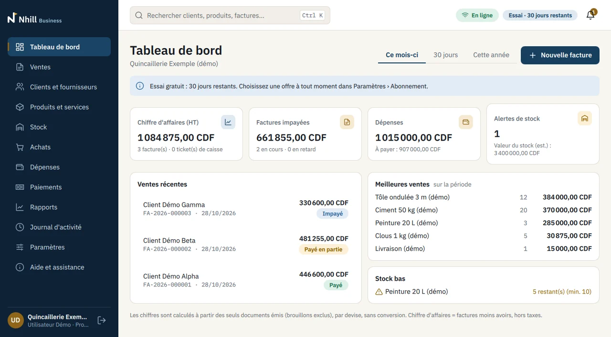
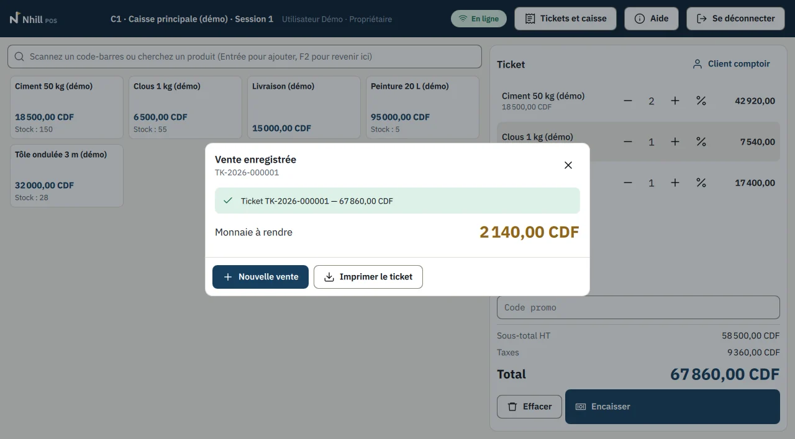
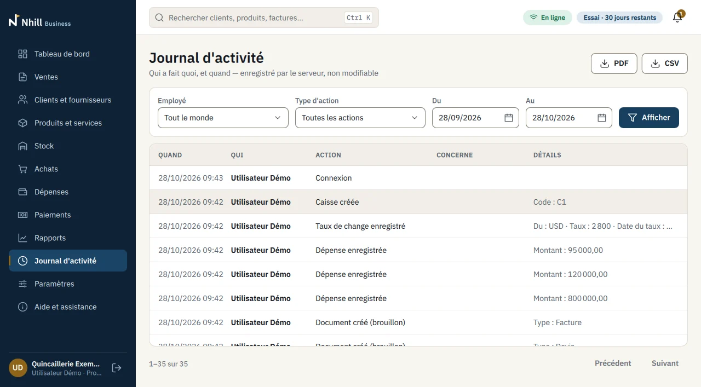
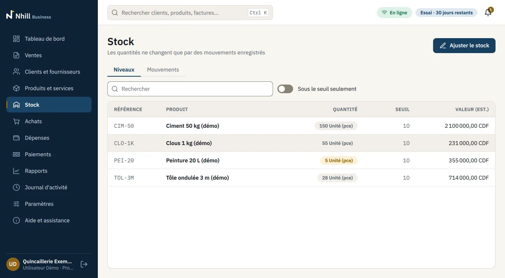

# Présentation commerciale (10 diapositives)

*English: [../en/14-sales-presentation.md](../en/14-sales-presentation.md)*

Contenu de la présentation à projeter ou à montrer sur tablette (15 minutes avant la
démonstration). Une seule idée par diapositive ; les captures sont des **écrans réels** de
Nhill 3.0 (dossier `website/assets/images/`, captures automatiques de la CI sur un
établissement de démonstration). Version diffusable : PDF généré depuis ce fichier
(`marketing/pdf/fr/14-presentation-commerciale.pdf`).

---

## Diapositive 1 — Titre

**Nhill — vos ventes, votre stock et votre caisse, au clair.**
Logiciel de gestion pour commerçants et PME · Kinshasa

## Diapositive 2 — Ce que nous entendons des commerçants

- « La caisse du soir ne tombe pas juste. »
- « Je découvre la rupture quand le client demande l'article. »
- « Je ne peux pas m'absenter du magasin. »

*(Formulations types tirées des entretiens de découverte ; pas des citations de clients.)*

## Diapositive 3 — Le constat

- 51 % des MPME interrogées utilisent des outils numériques ; 94 % des équipées ont un
  smartphone ; **19 %** seulement un logiciel de stock.
- Le coût est le premier frein (54 % des micro-entreprises).

Source : Malabar / Innogence / Fondation Roi Baudouin, avril 2025, 914 MPME (échantillon non
représentatif).

## Diapositive 4 — Nhill en une image

Trois applications, un seul serveur :
- **Nhill POS** — la caisse ;
- **Nhill Business** — ventes, stock, achats, dépenses, rapports, équipe ;
- votre téléphone — le tableau de bord, où que vous soyez.

## Diapositive 5 — À la caisse

Vendre vite (recherche `F2`, code-barres, encaissement `F9`), plusieurs paiements, monnaie
rendue, ticket 58/80 mm. Remise au-delà du plafond → accord d'un responsable, noté.

## Diapositive 6 — Le contrôle

- Clôture à l'aveugle : le caissier compte, Nhill calcule l'écart.
- Journal d'activité : qui a fait quoi, impossible à effacer.
- Un compte par personne.

## Diapositive 7 — Le stock et le crédit

Stock par mouvements, seuils d'alerte, réceptions d'achats ; factures, paiements partiels,
qui vous doit combien.

## Diapositive 8 — Adapté à Kinshasa

Français / anglais · CDF / USD sans mélange · coupure de réseau : pas de double
enregistrement · accompagnement sur place · Windows, Linux, Android (Nhill Business).
**Nhill ne remplace pas la facture normalisée DGI** pour les assujettis à la TVA.

## Diapositive 9 — L'essai gratuit accompagné

30 jours, gratuit, sans engagement : installation, import des produits, formation, point
chaque semaine, export de vos données à la fin.

## Diapositive 10 — Prochaine étape

Démonstration sur vos produits, maintenant ou au jour qui vous convient · demande d'essai :
nhill.online · info@nhill.online

---

Notes pour l'orateur : vérifier avant chaque rendez-vous que les plates-formes citées en
diapositive 8 sont bien livrées (`release/V3.0.0/`) et que le site nhill.online est en ligne
(`python3 website/tools/check_live.py`) avant d'en citer l'adresse ; ne jamais ajouter de
logo de client ou de partenaire sans autorisation écrite (`legal/fr/20`).
