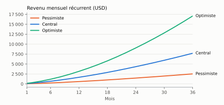
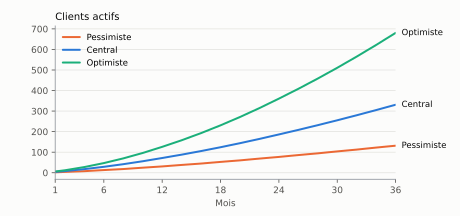
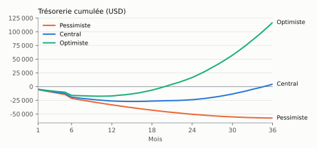

# Étude financière et marketing des abonnements Nhill

*English: [../en/16-subscription-financial-study.md](../en/16-subscription-financial-study.md)*

| | |
|---|---|
| Version | 1.0 — 27 octobre 2026 |
| Statut | **recommandations soumises à la validation du propriétaire du produit** : aucun prix n'est publié sur le site ni chargé dans la base |
| Méthode | prix publics relevés en ligne le 26 et le 27 octobre 2026 (§ 15), inspection du code de Nhill 2.1, modèle financier reproductible (`marketing/tools/subscription_model.py`) |
| Légende | **V** donnée vérifiée, avec sa source et sa date ; **H** hypothèse à valider ; les calculs sont faits par le script, jamais à la main |
| Monnaie de calcul | dollar américain (USD) ; 1 EUR = 1,149 USD (0,87 EUR pour 1 USD, relevé d'août 2026) |

## 1. Résumé exécutif

- **Positionnement recommandé** : Nhill est la solution tout-en-un des indépendants, des
  commerces et des PME qui veulent vendre, encaisser et suivre leur stock dès le premier
  jour, avec un **abonnement par établissement** (et non une licence par utilisateur)
  et un accompagnement au démarrage. Face aux ERP modulaires comme Odoo, l'argument est
  la mise en route rapide, les outils du quotidien déjà reliés et un coût prévisible
  quand l'équipe grandit.
- **Trois formules** (Solo, Commerce, PME) plus une offre sur mesure, construites sur les
  plafonds qui existent déjà dans le code (utilisateurs, caisses, dépôts). Prix proposés
  pour la **zone A** (pays à revenu faible ou intermédiaire inférieur, dont la RDC) :
  **9 $, 25 $ et 59 $ par mois**, 10 mois payés pour un abonnement annuel. Une **zone B**
  (revenu intermédiaire supérieur et élevé) à **15 $, 39 $ et 89 $** n'est à ouvrir
  qu'après le travail de conformité propre à chaque pays visé.
- **Seuil de rentabilité** : avec une équipe minimale (fondateur, un agent
  d'accompagnement, un commercial) et l'infrastructure actuelle, il faut **environ
  99 clients actifs** en zone A (64 en zone B).
- **Scénarios sur 36 mois** : équilibre d'exploitation durable au **mois 23** dans le
  scénario central (331 clients actifs au mois 36, revenu récurrent annuel d'environ
  92 000 $), au mois 15 dans l'optimiste, non atteint dans le pessimiste. Besoin de
  trésorerie maximal : **27 500 $** (central) à **58 100 $** (pessimiste).
- **Ce qui décide** : le nombre de démonstrations (45 par mois au mois 12 dans le
  scénario central), la résiliation (chaque point de plus coûte cher) et le prix réel
  accepté, à mesurer pendant le pilote avant toute publication.
- **Multidevise** : une grille de référence en USD, des grilles en CDF, EUR, XAF/XOF
  dérivées par une règle publiée et révisée, la devise de facturation choisie à la
  souscription ; aucun paiement par carte ou Mobile Money automatique n'est annoncé tant
  que l'intégration n'est pas testée en conditions réelles.

## 2. Le produit et ses segments cibles

### 2.1 Ce qui existe dans Nhill 2.1 (code inspecté)

| Domaine | Fonctions disponibles |
|---|---|
| Ventes | devis, commandes, factures, avoirs en PDF, paiements partiels, créances par devise |
| Caisse (Nhill POS, Windows et Linux) | sessions, plusieurs moyens de paiement par ticket, remises et annulations validées par un responsable, comptage à l'aveugle, écart, rapports X et Z |
| Stock et achats | stock par dépôt, mouvements, alertes de seuil, transferts, achats fournisseurs, dépenses |
| Pilotage | tableau de bord, rapports PDF et CSV, journal d'activité non modifiable, rôles par employé |
| Plateforme | Nhill Business sur Windows, Linux et Android ; français et anglais ; dix devises (USD, EUR, GBP, CHF, XAF, XOF, CDF, KES, RWF, ZAR) ; établissements isolés en base |
| Abonnements (Nhill Console) | offres avec plafonds `max_users`, `max_registers`, `max_warehouses`, option `multi_warehouse`, public visé (individuel, entreprise), prix **par durée (1, 3, 6, 12, 24, 36 mois) et par devise**, codes promotionnels, crédit au prorata lors d'un changement d'offre, essai de 30 jours (paramètre), grâce de 7 jours, lecture seule après suspension |
| Encaissement des abonnements | instructions de paiement manuel ; adaptateurs Stripe (cartes) et PayPal **testés uniquement contre un faux service local** ; Payoneer configuré sans adaptateur |

Hors périmètre aujourd'hui (à garder en tête pour le prix et la concurrence) :
comptabilité générale, caisse sur Android, envoi direct des documents par e-mail,
raccordement aux opérateurs Mobile Money, certification fiscale dans un pays (le profil
RDC est un brouillon à faire valider ; le profil international est générique).

### 2.2 Segments

| Segment | Besoin principal | Ce que Nhill apporte | Formule naturelle |
|---|---|---|---|
| Indépendant, solopreneur (prestataire, artisan, consultant, petit vendeur) | devis, factures, encaissements, savoir qui doit quoi | factures à son nom, paiements rattachés, dépenses, téléphone Android | Solo |
| Petite entreprise, boutique (2 à 5 personnes, une ou deux caisses) | caisse fiable, stock juste, contrôle des vendeurs | caisse avec écart, stock automatique, rôles, journal | Commerce |
| PME (6 à 15 personnes, plusieurs caisses ou dépôts) | contrôle à distance, plusieurs sites, rapports pour le comptable | plusieurs dépôts et caisses, rapports, exports | PME |
| Entreprise plus grande ou multi-établissements | besoins particuliers | sur devis, plusieurs établissements sous un même compte | Sur mesure |

Données de marché sur la RDC (étude de marché, document 01) : dans une enquête de 914
MPME, 51 % utilisent des outils numériques, mais 19 % seulement des MPME équipées ont
un logiciel de gestion de stock, et le coût est le premier frein cité (54 % des
micro-entreprises). Ces chiffres guident le niveau de prix de la zone A ; ils ne
mesurent pas un consentement à payer.

## 3. Marché et concurrence

### 3.1 Contexte économique de la zone de lancement (RDC)

| Donnée | Valeur | Source (V) |
|---|---|---|
| Classement Banque mondiale (exercice 2027, revenu national brut par habitant 2025) | RDC et Rwanda : revenu faible ; Cameroun, Côte d'Ivoire, Sénégal, Kenya, Nigeria, Congo-Brazzaville : intermédiaire inférieur ; Afrique du Sud, Gabon : intermédiaire supérieur. Seuils : faible ≤ 1 175 $, intermédiaire inférieur 1 176 à 4 635 $, intermédiaire supérieur 4 636 à 14 375 $, élevé > 14 375 $ | Afridigest, 8 juillet 2026, d'après la Banque mondiale |
| Préférence pour le dollar | « préférence pour le dollar » relevée par le FMI ; 13,0 milliards de dollars de dépôts en dollars dans le système bancaire | FMI, rapport pays n° 26/2, janvier 2026 |
| Croissance | PIB réel : +5,6 % en 2025, environ +5,3 % projeté en 2026 | FMI, rapport pays n° 26/2 (tableau 1 ; alignement des années à vérifier dans le PDF) |
| Change | 1 USD = 2 264,0000 CDF (taux officiel BCC, 26/10/2026) ; 2 317,50 CDF (marché, 23/10/2026), soit une dépréciation de 0,98 % sur un an | BCC (document 01, S3) ; Trading Economics |

Conséquence : un prix de référence en USD est cohérent avec les habitudes de la cible ;
une grille en CDF reste nécessaire pour ceux qui paient en francs, avec une règle de
révision (§ 11).

### 3.2 Concurrents directs et indirects

| Solution | Catégorie | Modèle de prix | Forces | Où Nhill se distingue |
|---|---|---|---|---|
| Odoo | ERP modulaire | par utilisateur et par mois, grille par pays ; une application gratuite | très large couverture (comptabilité, CRM, caisse, fabrication…) | démarrage accompagné, outils du quotidien déjà reliés, prix par établissement |
| Zoho Books, Zoho Inventory | comptabilité et stock en ligne | par organisation, utilisateurs inclus par palier ; offre gratuite sous un seuil de chiffre d'affaires | comptabilité complète, prix bas, grilles locales (Kenya) | caisse intégrée avec contrôle, stock et ventes au comptoir dans le même outil |
| QuickBooks Online | comptabilité | par entreprise, utilisateurs par palier | comptabilité, écosystème d'experts-comptables | prix adapté aux petites structures de la zone A, caisse incluse |
| Sage Accounting (Afrique) | comptabilité | par entreprise, options payantes (multidevise, stock avancé) | présence africaine, prix en USD au Kenya et au Nigeria | multidevise et stock inclus, caisse |
| Loyverse, Square | caisse | caisse gratuite, options payantes par magasin | gratuit pour démarrer, matériel | devis, factures, créances, achats, multidevise dans le même outil |
| Dolibarr (DoliCloud), ERPNext (Frappe Cloud) | ERP libres hébergés | par utilisateur (DoliCloud) ou forfait (ERPNext) | logiciels libres, larges | prise en main, accompagnement, caisse avec contrôle |
| Cahier, tableur, logiciels de caisse locaux | alternatives actuelles | gratuit ou licence | connus, sans abonnement | traçabilité, suivi à distance, plusieurs postes |

Menace principale : les offres **gratuites** (Odoo une application, Zoho Books gratuit,
Loyverse) sur l'entrée de gamme. Réponse : Nhill ne gagne pas le segment Solo par le prix
seul, mais par l'outil complet (caisse + factures + stock), la simplicité et
l'accompagnement ; le prix Solo doit rester sous le seuil psychologique de 10 $.

## 4. Comparaison des tarifs et des fonctionnalités

Prix publics relevés, hors taxes, en USD sauf mention. Les données d'Odoo proviennent de
pages tierces qui reproduisent odoo.com (la page officielle n'a pas pu être lue par nos
outils) : **à vérifier sur odoo.com depuis le pays de contractualisation** avant toute
communication.

| Solution et palier | Prix relevé | Utilisateurs / limites | Caisse | Stock | Multidevise | Source (date) |
|---|---|---|---|---|---|---|
| Odoo Standard, liste États-Unis | 24,90 $ par utilisateur et par mois la 1re année, puis 31,10 $ (annuel) ; mensuel +20 à 25 % | par utilisateur | application incluse | oui | oui | ERP Research, juillet 2026 ; Cybrosys |
| Odoo Standard, liste « Afrique subsaharienne » | 8,95 $ par utilisateur et par mois (annuel) ; Custom 13,60 $ | par utilisateur | oui | oui | oui | OEC.sh, vérifié le 18 octobre 2026 |
| Odoo « One App Free » | 0 $ | une seule application, utilisateurs illimités, sans Studio ni multisociété | si l'application choisie est la caisse | non (autre application) | — | Cybrosys |
| Zoho Books (États-Unis) | gratuit (CA < 50 000 $), Standard 15 $ (annuel) / 20 $, Professional 40 $ / 50 $, Premium 60 $ / 70 $ ; utilisateur supplémentaire 2,50 $ / 3 $ | 1, 3, 5, 10 | non | dès Professional | dès Professional | zoho.com, 27/10/2026 |
| Zoho Books (Kenya) | Standard 849 KSh (≈ 6,54 $), Professional 1 699 KSh (≈ 13,08 $), Premium 2 499 KSh (≈ 19,24 $) par mois, annuel | 3, 5, 10 | non | dès Professional | dès Professional | zoho.com/ke, 27/10/2026 ; 1 USD = 129,907 KSh au 26/10/2026 |
| Zoho Inventory (États-Unis, annuel) | Standard 29 $, Premium 79 $, Plus 129 $, Enterprise 249 $ ; gratuit : 50 commandes | 3 à 10 ; 2 à 10 emplacements | non | oui | — | zoho.com, 27/10/2026 |
| QuickBooks Online (États-Unis) | Simple Start 38 $, Essentials 85 $, Plus 140 $, Advanced 340 $ (−50 % trois mois en promotion) | 1, 3, 5, 25 | non | Plus | — | quickbooks.intuit.com, 27/10/2026 |
| Sage Accounting (Kenya, Nigeria) | Start 12,33 $, Standard 23,67 $ par mois ; options en Afrique du Sud : multidevise 185 R, stock avancé 465 R par mois | 1 ; 2 (jusqu'à 5) | non | option | option | sage.com/africa, 27/10/2026 |
| Loyverse | caisse gratuite ; gestion des employés 25 $, stock avancé 25 $ par magasin et par mois (250 $ par an chacun) | par magasin | oui | essentiel gratuit, avancé payant | — | loyverse.com, 27/10/2026 |
| Square (États-Unis) | Free 0 $, Plus 49 $, Premium 149 $ par établissement et par mois ; paiement en personne 2,5 % + 0,15 $ (Plus) | par établissement | oui | oui | — | communiqué Square, 6 octobre 2025 |
| DoliCloud (Dolibarr hébergé) | Basic 14 € par utilisateur et par mois ; Premium 30 € + 15 € par utilisateur | par utilisateur | module | oui | oui | dolicloud.com, 27/10/2026 |
| ERPNext, offre Small Business (Frappe Cloud) | 50 $ par mois, utilisateurs illimités | illimités | oui | oui | oui | annonce Frappe, 14 août 2023 (ancienne, à revérifier) |

Coût mensuel comparé pour trois profils types, zone A (abonnement annuel ramené au mois
quand le prix publié est annuel) :

| Profil | Nhill (proposé) | Odoo Standard, liste Afrique subsaharienne | Zoho Books Kenya | Loyverse avec employés et stock avancé |
|---|---|---|---|---|
| Indépendant, 1 utilisateur | Solo : 9 $ (7,50 $ en annuel) | 8,95 $ | gratuit (sous le seuil) ou 6,54 $ | 0 $ (caisse seule) à 50 $ |
| Boutique, 5 utilisateurs, 2 caisses | Commerce : 25 $ (20,83 $ en annuel) | 44,75 $ (5 × 8,95 $) | 13,08 $ (sans caisse) | 50 $ par magasin |
| PME, 15 utilisateurs, 5 caisses, 3 dépôts | PME : 59 $ (49,17 $ en annuel) | 134,25 $ (15 × 8,95 $) | 19,24 $ pour 10 utilisateurs (sans caisse) | 150 $ pour 3 magasins |

Lecture : Nhill est **plus accessible qu'un ERP facturé par utilisateur dès que l'équipe
dépasse deux ou trois personnes**, et reste proche des prix d'entrée du marché pour un
indépendant. Les logiciels de comptabilité seuls sont moins chers mais ne couvrent pas la
caisse ; les caisses gratuites ne couvrent pas les devis, les factures et les créances.

## 5. Modèle économique recommandé

1. **Abonnement par établissement**, avec des plafonds d'utilisateurs, de caisses et de
   dépôts (mécanisme existant) ; pas de licence par utilisateur.
2. **Paiement mensuel ou annuel** ; l'annuel donne deux mois (10 mois payés). Le
   trimestriel (3 mois, sans remise) est proposé en zone A, où les trésoreries sont
   courtes ; les durées de 6, 24 et 36 mois existent dans le code mais ne sont pas
   recommandées au lancement.
3. **Essai accompagné gratuit** (programme pilote de huit semaines, puis essai de
   30 jours) : la conversion se fait sur l'usage réel.
4. **Services ponctuels facturés à part** (formation supplémentaire, reprise de données
   complexe, installation hors Kinshasa) : prix à fixer après mesure du temps passé
   pendant le pilote.
5. **Pas d'options payantes au lancement** : le code ne gère pas d'options à l'unité ;
   les plafonds suffisent à différencier les formules.
6. **Deux zones de prix** fondées sur un critère objectif et public (classement de la
   Banque mondiale du pays de l'établissement), pas sur une conversion monétaire.

## 6. Plans et prix proposés

<!-- model:plans -->
| Formule | Pour qui | Utilisateurs | Caisses POS | Dépôts | Prix mensuel, zone A | Annuel, zone A (10 mois) | Prix mensuel, zone B | Annuel, zone B |
|---|---|---|---|---|---|---|---|---|
| Solo | indépendant, solopreneur | 1 | 1 | 1 | 9 $ | 90 $ | 15 $ | 150 $ |
| Commerce | petite entreprise, boutique | 5 | 2 | 1 | 25 $ | 250 $ | 39 $ | 390 $ |
| PME | PME, plusieurs sites | 15 | 5 | 3 | 59 $ | 590 $ | 89 $ | 890 $ |
| Sur mesure | au-delà de 15 utilisateurs, 5 caisses ou 3 dépôts | sur devis | sur devis | sur devis | sur devis | sur devis | sur devis | sur devis |
<!-- /model -->

Correspondance avec la base (à saisir dans Nhill Console **après validation**) : `plans`
(`code` solo, commerce, pme ; `max_users`, `max_registers`, `max_warehouses`,
`features.multi_warehouse` vrai pour PME, `audience` individual pour Solo) et
`plan_prices` (durées 1, 3 et 12 mois ; une ligne par devise de facturation).

## 7. Justification de chaque prix

| Formule | Prix zone A | Justification |
|---|---|---|
| Solo | 9 $ par mois | sous le seuil de 10 $ ; au niveau de la liste Odoo Afrique subsaharienne pour un utilisateur (8,95 $, sur l'annuel) et de Sage Start Kenya (12,33 $) ; couvre largement le coût de service (§ 8.3) ; doit rester un tremplin vers Commerce |
| Commerce | 25 $ par mois | cœur de gamme : 5 utilisateurs et 2 caisses pour près de la moitié du prix d'Odoo pour 5 utilisateurs (44,75 $) et la moitié de Loyverse avec employés et stock avancé (50 $ par magasin) ; arrondi lisible ; ARPA du modèle centrée sur cette formule |
| PME | 59 $ par mois | multi-dépôts et 15 utilisateurs : moins de la moitié d'Odoo pour 15 utilisateurs (134,25 $) ; écart avec Commerce assez net pour que la montée de formule soit motivée par le besoin (dépôts, caisses) |
| Sur mesure | sur devis | au-delà des plafonds, besoins d'intégration ou d'accompagnement particuliers |
| Zone B | 15, 39 et 89 $ | même structure ; reste nettement sous QuickBooks (38 à 140 $) et Odoo États-Unis par utilisateur (24,90 à 31,10 $ chacun), et augmente d'environ 55 % la contribution par client (37,22 $ contre 24,02 $) |

Tests à mener pendant le pilote, avant publication : questionnaire de sensibilité au
prix (Van Westendorp : trop cher, cher, bon marché, trop bon marché) auprès de chaque
pilote, et trois propositions écrites différentes (Solo 7 / 9 / 12 $, Commerce 19 / 25 /
35 $) suivies jusqu'à la signature. Le prix retenu est celui qui maximise le revenu par
démonstration, pas le taux de signature seul.

## 8. Budget prévisionnel et structure des coûts

### 8.1 Hypothèses de coûts

<!-- model:hypotheses -->
| Hypothèse | Valeur | Nature |
|---|---|---|
| Serveur d'application Hetzner CX23 (2 vCPU, 4 Go, 40 Go) 5,99 € + sauvegardes 20 % | 8,26 $ / mois | vérifiée |
| Base PostgreSQL gérée Supabase Pro (8 Go, sauvegarde quotidienne 7 jours) | 25 $ / mois | vérifiée |
| Sauvegardes chiffrées hors site (Backblaze B2, 6,95 $/To ; 10 Go gratuits) | 1 $ / mois | hypothèse |
| Envoi d'e-mails (Amazon SES, 0,10 $ / 1 000 e-mails) | 1 $ / mois | hypothèse |
| Nom de domaine (20 $ par an) | 1,67 $ / mois | hypothèse |
| Signature des installateurs Windows (Azure Artifact Signing, 9,99 $ annoncés, à confirmer) | 9,99 $ / mois | hypothèse |
| Outils : assistance, CRM, visioconférence, bureautique | 45 $ / mois | hypothèse |
| Comptable, frais juridiques et administratifs | 150 $ / mois | hypothèse |
| Données mobiles, téléphone, déplacements de l'équipe | 80 $ / mois | hypothèse |
| Supports de démonstration, impressions, petits événements | 150 $ / mois | hypothèse |
| Rémunération du fondateur (produit, développement) | 1 000 $ / mois | hypothèse |
| Agent d'accompagnement et d'assistance (1 par tranche de 150 clients actifs) | 500 $ / mois | hypothèse |
| Clients actifs suivis par agent d'assistance | 150 | hypothèse |
| Commercial terrain, salaire fixe (1 de plus au-delà de 12 puis 24 nouveaux clients par mois) | 400 $ / mois | hypothèse |
| Prime du commercial par nouveau client payant | 15 $ / nouveau client | hypothèse |
| Déplacement et supports par nouveau client | 10 $ / nouveau client | hypothèse |
| Frais d'encaissement moyens (Mobile Money 2,5-3,2 % via agrégateur, virements, cartes) | 3,5 % | hypothèse |
| Part des nouveaux clients apportés par un partenaire | 20,0 % | hypothèse |
| Commission partenaire sur la première année encaissée | 20,0 % | hypothèse |
| Part des nouveaux clients venus par recommandation (1 mois offert au parrain) | 15,0 % | hypothèse |
| Remises moyennes (codes promotionnels, gestes commerciaux) | 5,0 % | hypothèse |
| Établissements actifs par serveur d'application (aucun test de charge réalisé) | 250 | hypothèse |
| Établissements actifs au-delà desquels la base passe à la puissance supérieure (+15 $/mois) | 500 | hypothèse |
<!-- /model -->

Dépenses ponctuelles :

<!-- model:one_off -->
| Mois | Dépense ponctuelle | Montant | Nature |
|---|---|---|---|
| M1 | Création de la société, conseil juridique et fiscal | 1 500 $ | hypothèse |
| M1 | Matériel de démonstration (imprimante de tickets, lecteur, tablette Android) | 1 200 $ | hypothèse |
| M1 | Compte développeur Google Play (paiement unique) | 25 $ | vérifiée |
| M1 | Identité visuelle imprimée, cartes, kakémono | 500 $ | hypothèse |
| M6 | Test d'intrusion externe avant un déploiement large | 5 000 $ | hypothèse |
<!-- /model -->

Sources des prix vérifiés : Hetzner CX23 à 5,99 € par mois avec IPv4 (relevé d'août 2026,
après l'ajustement de prix du 15 juin 2026) et sauvegardes à 20 % du prix du serveur
(documentation Hetzner) ; Supabase Pro à 25 $ par mois (8 Go de base, sauvegarde
quotidienne conservée 7 jours, 10 $ de crédit de calcul) ; Backblaze B2 à 6,95 $ par To
et par mois ; Amazon SES à 0,10 $ les 1 000 e-mails ; Google Play à 25 $ une fois.
Le prix d'Azure Artifact Signing n'est pas affiché sur sa page : 9,99 $ par mois est le
chiffre cité sur le forum de Microsoft (octobre 2025), **à confirmer**. Le dimensionnement
de départ (2 vCPU, 4 Go, 40 Go) est celui du guide de déploiement de Nhill.

### 8.2 Coûts mensuels du scénario central

<!-- model:costs -->
| Poste (scénario central) | Mois 1 | Mois 12 | Mois 24 | Mois 36 |
|---|---|---|---|---|
| Infrastructure et signature | 47 $ | 47 $ | 47 $ | 55 $ |
| Équipe | 1 900 $ | 1 900 $ | 2 800 $ | 3 300 $ |
| Outils, comptable, télécoms, marketing fixe | 425 $ | 425 $ | 425 $ | 425 $ |
| Acquisition variable (primes, déplacements, parrainage) | 114 $ | 256 $ | 427 $ | 598 $ |
| Commissions partenaires | 4 $ | 67 $ | 127 $ | 188 $ |
| Frais d'encaissement | 14 $ | 66 $ | 165 $ | 286 $ |
| Total des coûts récurrents | 2 504 $ | 2 761 $ | 3 991 $ | 4 853 $ |
| Revenu mensuel récurrent | 94 $ | 1 669 $ | 4 340 $ | 7 707 $ |
| Résultat d'exploitation | -2 399 $ | -1 085 $ | 361 $ | 2 870 $ |
<!-- /model -->

### 8.3 Coût de service par client

<!-- model:unit_costs -->
| Coût de service par client actif et par mois (central) | Mois 12 | Mois 36 |
|---|---|---|
| Serveurs, base, sauvegardes, e-mails, signature | 0,66 $ | 0,17 $ |
| Assistance (agents) | 6,98 $ | 4,53 $ |
| Frais d'encaissement | 0,92 $ | 0,87 $ |
| Total | 8,56 $ | 5,57 $ |
| Revenu moyen par client (ARPA) | 23,31 $ | 23,29 $ |
<!-- /model -->

L'infrastructure coûte moins d'un dollar par client et par mois ; le coût de service
dépend surtout du temps d'assistance. **Inconnue majeure** : aucun test de charge n'a été
mené ; le nombre d'établissements par serveur (250) est une hypothèse prudente à
remplacer par une mesure avant 100 clients.

## 9. Seuil de rentabilité

Coûts fixes du mois type : fondateur, un agent d'accompagnement, un commercial,
infrastructure, outils, comptable, télécoms, marketing fixe. Contribution par client :
ARPA du mix central, remises déduites, moins les frais d'encaissement.

<!-- model:break_even -->
| Zone de prix | ARPA (mix central, remises déduites) | Coûts fixes du mois type | Contribution par client | Clients actifs pour l'équilibre |
|---|---|---|---|---|
| A (lancement) | 24,89 $ | 2 372 $ | 24,02 $ | 99 |
| B | 38,57 $ | 2 372 $ | 37,22 $ | 64 |
<!-- /model -->

Formule : clients nécessaires = coûts fixes ÷ (ARPA × (1 − frais d'encaissement)). Au-delà
de 150 clients, un deuxième agent d'accompagnement (+500 $) relève le seuil d'environ
21 clients en zone A.

## 10. Scénarios financiers sur 36 mois

Le mois 1 est le premier mois de commercialisation après le pilote (date à fixer).
Paramètres :

<!-- model:scenario_inputs -->
| Paramètre | Pessimiste | Central | Optimiste |
|---|---|---|---|
| Nouveaux clients payants au mois 1 | 2 | 4 | 6 |
| Progression | +1 tous les 4 mois | +1 tous les 2 mois | +2 tous les 2 mois |
| Plafond mensuel de nouveaux clients | 10 | 25 | 45 |
| Résiliation mensuelle | 5 % | 3 % | 2 % |
| Répartition Solo / Commerce / PME | 45 / 45 / 10 % | 35 / 45 / 20 % | 30 / 45 / 25 % |
| Part d'abonnements annuels | 25 % | 35 % | 45 % |
<!-- /model -->

Résultats :

<!-- model:results -->
| Indicateur | Pessimiste | Central | Optimiste |
|---|---|---|---|
| Clients actifs, mois 12 | 31 | 72 | 126 |
| Clients actifs, mois 24 | 77 | 186 | 361 |
| Clients actifs, mois 36 | 132 | 331 | 681 |
| Revenu mensuel récurrent (MRR), mois 12 | 586 $ | 1 669 $ | 3 163 $ |
| Revenu mensuel récurrent (MRR), mois 24 | 1 471 $ | 4 340 $ | 9 055 $ |
| Revenu mensuel récurrent (MRR), mois 36 | 2 517 $ | 7 707 $ | 17 087 $ |
| Revenu annuel récurrent (ARR), mois 36 | 30 199 $ | 92 478 $ | 205 047 $ |
| Revenu moyen par client (ARPA), mois 36 | 19 $ / mois | 23 $ / mois | 25 $ / mois |
| Mois d'équilibre d'exploitation durable | non atteint en 36 mois | M23 | M15 |
| Besoin de trésorerie maximal (creux cumulé) | 58 126 $ au mois 36 | 27 472 $ au mois 15 | 17 789 $ au mois 10 |
| Trésorerie cumulée, mois 36 | -58 126 $ | 3 683 $ | 116 258 $ |
| Coût d'acquisition moyen (CAC) | 125 $ | 96 $ | 83 $ |
| Marge brute (encaissement, serveurs, assistance) | 48 % | 72 % | 78 % |
| Valeur vie client (LTV) | 182 $ | 556 $ | 978 $ |
| LTV / CAC | 1,4 | 5,8 | 11,8 |
| Récupération du CAC | 13,8 mois | 5,8 mois | 4,2 mois |
| Démonstrations nécessaires au mois 12 | 20 | 45 | 80 |
<!-- /model -->







Sensibilité du scénario central :

<!-- model:sensitivity -->
| Variante du scénario central | Mois d'équilibre | Besoin de trésorerie maximal | Trésorerie cumulée, mois 36 |
|---|---|---|---|
| Scénario central tel quel | M23 | 27 472 $ | 3 683 $ |
| Prix −20 % | M27 | 34 596 $ | -21 378 $ |
| Prix +20 % | M16 | 24 161 $ | 28 744 $ |
| Résiliation 4 % par mois | M24 | 28 034 $ | -2 863 $ |
| Fondateur non rémunéré pendant 36 mois | M13 | 14 690 $ | 39 683 $ |
| Base de données auto-hébergée (2e CX23 au lieu de Supabase) | M23 | 27 221 $ | 4 286 $ |
<!-- /model -->

Lecture : le prix et la résiliation pèsent le plus ; un prix inférieur de 20 % repousse
l'équilibre de quatre mois et laisse la trésorerie négative au mois 36. La rémunération
du fondateur est le principal levier de trésorerie à court terme. Le choix de la base
(Supabase ou serveur auto-hébergé) change peu le résultat ; il se décide sur la fiabilité
et le temps d'exploitation.

## 11. Stratégie multidevise et internationale

### 11.1 Trois notions distinctes

| Notion | Règle recommandée | Ce qui existe dans le code |
|---|---|---|
| Devise d'affichage | la devise de la proposition écrite et de l'écran d'abonnement est **la devise de facturation choisie** ; le site n'affiche aucun prix | prix stockés par devise dans `plan_prices` ; pas de conversion à l'affichage |
| Devise de facturation | choisie à la souscription parmi les grilles publiées (USD partout ; EUR ; CDF en RDC ; XAF ou XOF en zones CEMAC et UEMOA ; KES et RWF à l'ouverture de ces pays) ; inchangée jusqu'au renouvellement | une commande d'abonnement porte sa devise ; le prestataire de paiement déclare les devises qu'il accepte |
| Conversion | jamais silencieuse : un montant facturé n'est pas converti ; les grilles non USD sont **dérivées** de la grille USD par une règle publiée ; les rapports internes consolident en USD au taux du jour du paiement | grilles saisies dans la console ; rapports de la plateforme par devise |

### 11.2 Règle de dérivation des grilles

Prix local = prix USD × taux de référence, arrondi à un prix rond (500 CDF ; 100 XAF/XOF ;
1 € ; 10 KSh). Taux de référence : BCC pour le CDF, taux fixe euro / franc CFA via
l'EUR, banque centrale du pays sinon. Révision **trimestrielle**, ou plus tôt si le taux
s'écarte de plus de 5 % de celui de la dernière révision ; les abonnés gardent leur prix
jusqu'au renouvellement ; tout changement est annoncé 30 jours avant. Exemple (taux BCC du
26/10/2026, 2 264 CDF) : Commerce 25 $ ≈ 56 600 CDF → **56 500 CDF** par mois.

Zone B : grilles USD et EUR fixées comme des **prix de marché** (mêmes valeurs
numériques, 15 / 39 / 89), pas comme des conversions ; GBP et CHF au moment d'ouvrir ces
marchés.

### 11.3 Encaissement : ce qui est prêt, ce qui ne l'est pas

| Moyen | État | Recommandation |
|---|---|---|
| Virement, Mobile Money vers le compte de l'éditeur, confirmé dans la console | utilisable dès le lancement (instructions de paiement, commande validée par l'administrateur) | méthode du lancement en zone A |
| Agrégateur Mobile Money (par exemple pawaPay : collecte en RDC 2,5 % M-Pesa, 3 % Orange, 3,2 % Airtel, page « remittance », contrat entreprise) | **aucun adaptateur** ; l'adaptateur générique exige que l'agrégateur appelle le format signé de Nhill | développer un adaptateur dédié (estimation H : 2 à 4 semaines) avant 100 clients |
| Carte via Stripe | adaptateur écrit, **non vérifié** contre l'API réelle ; la RDC ne figure pas dans la liste des pays de Stripe (page « global » : en Afrique, Côte d'Ivoire, Ghana, Kenya, Nigeria et Afrique du Sud, via Paystack) ; aux États-Unis : 2,9 % + 0,30 $, +1,5 % carte internationale, +1 % conversion, +0,7 % Stripe Billing | n'annoncer la carte qu'après un paiement réel de contrôle, et seulement avec une entité éligible |
| PayPal | adaptateur écrit, non vérifié ; disponibilité pour un vendeur établi en RDC non confirmée | à vérifier avant tout engagement |

Taxes : prix proposés **hors taxes** ; le taux de TVA par offre existe (`tax_rate_bp`).
Le traitement de la TVA d'un abonnement logiciel en RDC (16 % dans le profil CD) et des
ventes à l'étranger est à valider avec un fiscaliste avant la première facture.

### 11.4 Conformité par pays (avant d'ouvrir la zone B)

Exemple de la France : réception des factures électroniques obligatoire pour toutes les
entreprises au 1er septembre 2026, émission au 1er septembre 2026 pour les grandes
entreprises et les ETI, au 1er septembre 2027 pour les PME et micro-entreprises
(service-public.gouv.fr, mise à jour du 27 février 2026) ; logiciels de caisse des
assujettis à la TVA soumis aux conditions d'inaltérabilité, de sécurisation, de
conservation et d'archivage (article 286 I 3° bis du CGI), justifiées par certificat ou
attestation individuelle de l'éditeur (réponse ministérielle du 10 mars 2026). Nhill ne
satisfait pas aujourd'hui ces exigences : un marché comme la France suppose un projet de
conformité dédié. Les pays visés en premier doivent être choisis aussi sur ce critère.

## 12. Plan marketing et stratégie d'acquisition

Principe : acquisition par la relation, sans publicité agressive, cohérente avec le
programme pilote et le modèle de partenaires (documents 02 et 09).

| Levier | Mise en œuvre | Indicateur | Coût dans le modèle |
|---|---|---|---|
| Démonstrations sur les produits du prospect (pari principal) | prospection terrain ciblée à Kinshasa (segments A et B du document 01), démonstration de 45 minutes, essai accompagné | démonstrations par semaine, taux démonstration → essai, essai → client | commercial (400 $ + 15 $ par client), 10 $ de déplacement par client |
| Partenaires (comptables, revendeurs informatiques, associations professionnelles, incubateurs) | accord écrit, commission de 20 % sur la première année encaissée | clients apportés par partenaire actif | 20 % de la 1re année pour 20 % des clients |
| Recommandation | un mois offert au parrain (code promotionnel « nouveaux clients », mécanisme existant) | part des clients recommandés | un mois d'ARPA pour 15 % des clients |
| Présence internationale entrante | site bilingue optimisé, fiches sur les annuaires de logiciels, contenus courts sur LinkedIn et WhatsApp, démonstrations en visioconférence | demandes de démonstration hors RDC | marketing fixe 150 $ par mois |
| Preuves | études de cas des pilotes, uniquement avec leur accord écrit, sans chiffres non mesurés | — | — |

Objectifs de volume dérivés du scénario central : 9 nouveaux clients au mois 12, soit
**45 démonstrations par mois** avec les hypothèses de conversion (démonstration → essai
50 %, essai → client 40 %, H) ; 21 clients au mois 36. Ces taux sont à remplacer par ceux
du pilote dès qu'ils sont mesurés.

## 13. Risques, hypothèses et recommandations

| Risque | Effet | Parade |
|---|---|---|
| Consentement à payer inférieur aux hypothèses | équilibre repoussé (prix −20 % : M27) | tests de prix du pilote avant publication ; formule Solo comme porte d'entrée |
| Offres gratuites (Odoo une application, Zoho Books gratuit, Loyverse) | pression sur Solo | vendre l'outil complet et l'accompagnement ; ne pas baisser Solo sous 7 $ sans mesure |
| Résiliation élevée | LTV divisée (pessimiste : LTV/CAC 1,4) | accompagnement des 90 premiers jours, suivi d'usage, annuel encouragé |
| Encaissement difficile (Mobile Money manuel, cartes indisponibles en RDC) | retards, impayés, temps passé | adaptateur agrégateur avant 100 clients ; trimestriel et annuel |
| Dépréciation du CDF | revenus en CDF érodés | grille USD de référence, révision trimestrielle de la grille CDF |
| Conformité fiscale par pays | marché fermé (France) ou risque pour le client | zone B pays par pays après analyse ; transparence dans la documentation |
| Capacité technique inconnue | coûts ou incidents à la croissance | test de charge avant 100 clients ; supervision |
| Sécurité (aucun test d'intrusion externe) | confiance, responsabilité | test d'intrusion budgété au mois 6 |
| Dépendance au fondateur | continuité | documentation, agent d'accompagnement formé, rythme de livraison soutenable |
| Hypothèses de coûts d'équipe | résultat sensible | budget réel à saisir dans le script, scénarios relancés |

Hypothèses à valider en priorité : salaires réels, temps d'assistance par client,
conversion du pilote, frais d'encaissement réels, traitement de la TVA, capacité par
serveur, entité juridique et moyens de paiement accessibles.

Recommandations :

1. Valider la structure (trois formules + sur mesure, abonnement par établissement,
   annuel à 10 mois) ; garder les prix comme hypothèses de test jusqu'à la fin du pilote.
2. Lancer en zone A (RDC, puis pays francophones à revenu faible ou intermédiaire
   inférieur) ; n'ouvrir la zone B qu'après une analyse de conformité par pays.
3. Encaisser manuellement au lancement, développer l'adaptateur Mobile Money avant
   100 clients, n'annoncer la carte qu'après un paiement réel de contrôle.
4. Prévoir un financement d'au moins **28 000 $** (scénario central) et une marge pour le
   scénario pessimiste (58 000 $ sur 36 mois), ou réduire les coûts fixes au départ.
5. Revoir l'étude tous les trimestres avec les chiffres réels (script relancé).

## 14. Plan d'action priorisé pour le lancement

| Priorité | Action | Responsable | Échéance indicative | Condition |
|---|---|---|---|---|
| 1 | Valider la structure des formules et les zones de prix | propriétaire du produit | semaine 1 | — |
| 1 | Questionnaire de prix et trois propositions tests pendant le pilote | équipe commerciale | pilote (8 semaines) | pilotes recrutés |
| 1 | Valider TVA, entité juridique, comptes de paiement | propriétaire, fiscaliste | avant la 1re facture | — |
| 2 | Saisir les offres et grilles dans Nhill Console (sans les publier sur le site) | administrateur de la plateforme | après validation | prix validés |
| 2 | Test de charge et supervision | équipe technique | avant 100 clients | — |
| 2 | Adaptateur agrégateur Mobile Money (essai réel) | équipe technique | avant 100 clients | contrat d'agrégateur |
| 2 | Recruter et former l'agent d'accompagnement et le commercial | propriétaire | mois 1 | financement |
| 3 | Programme partenaires et recommandation (codes promotionnels) | équipe commerciale | mois 2 | accords écrits |
| 3 | Test d'intrusion externe | propriétaire | mois 6 | budget |
| 3 | Analyse de conformité du premier pays de zone B | propriétaire, juriste local | après 12 mois | équilibre en vue |
| 4 | Publication éventuelle des prix sur le site | propriétaire | après validation explicite | résultats du pilote |

## 15. Sources

Consultées les 26 et 27 octobre 2026, sauf mention.

| Sujet | Source |
|---|---|
| Odoo (prix, États-Unis, promotion et renouvellement) | [ERP Research — Odoo pricing](https://www.erpresearch.com/pricing/odoo) (prix « as of July 2026 ») ; [Cybrosys — Odoo pricing](https://www.cybrosys.com/odoo/odoo-pricing/) |
| Odoo (grilles régionales) | [OEC.sh — Odoo pricing 2026](https://oec.sh/odoo-pricing) (« last verified October 18, 2026 ») ; page officielle [odoo.com/pricing](https://www.odoo.com/pricing) non lisible par nos outils |
| Odoo (coûts d'intégration, États-Unis et Canada) | [Octura Solutions, 18 avril 2026](https://octurasolutions.com/resources/odoo-pricing-2026-complete-transparent-breakdown-us-canada) |
| Zoho Books, Zoho Inventory | [Zoho Books US](https://www.zoho.com/us/books/pricing/) ; [Zoho Books Kenya](https://www.zoho.com/ke/books/pricing/) ; [Zoho Inventory](https://www.zoho.com/us/inventory/pricing/) |
| QuickBooks Online | [quickbooks.intuit.com/pricing](https://quickbooks.intuit.com/pricing/) |
| Sage Accounting Afrique | [sage.com/africa — pricing](https://www.sage.com/africa/sage-business-cloud/accounting/pricing/) |
| Loyverse | [loyverse.com/pricing](https://loyverse.com/pricing) |
| Square | [Square — unified pricing, 6 octobre 2025](https://squareup.com/us/en/press/unified-pricing-and-packaging) |
| DoliCloud | [dolicloud.com — pricing](https://www.dolicloud.com/en-pricing.php) |
| ERPNext | [Frappe — Small Business plan, 14 août 2023](https://frappe.io/blog/announcements/introducing-the-erpnext-small-business-plan) |
| Hetzner | [Hausse du 15 juin 2026](https://privatedevops.com/news/hetzner-june-2026-cloud-price-increase-what-to-do) ; [comparatif août 2026](https://kimmo.suominen.com/stuff/cpc-2026-08.txt) ; [CX23](https://www.vpsbenchmarks.com/hosters/hetzner/plans/cx23) ; [FAQ facturation Hetzner](https://docs.hetzner.com/cloud/billing/faq/) |
| Supabase | [supabase.com/pricing](https://supabase.com/pricing) |
| Backblaze B2 | [backblaze.com — pricing](https://www.backblaze.com/cloud-storage/pricing) |
| Amazon SES | [aws.amazon.com/ses/pricing](https://aws.amazon.com/ses/pricing/) |
| Google Play | [Play Console Help](https://support.google.com/googleplay/android-developer/answer/6112435?hl=en) |
| Azure Artifact Signing | [page de prix](https://azure.microsoft.com/en-us/pricing/details/trusted-signing/) (montants non affichés) ; [Microsoft Q&A, octobre 2025](https://learn.microsoft.com/en-us/answers/questions/5595324/i-signed-up-to-generate-certificates-to-sign-my-co) |
| Stripe | [stripe.com/pricing](https://stripe.com/pricing) ; [stripe.com/global](https://stripe.com/global) |
| pawaPay | [pawapay.io/fees](https://pawapay.io/fees) |
| Paiements en RDC | [CartDNA — DRC payment guide](https://cartdna.com/en/shopify-payment-guide/africa/democratic-republic-of-congo) |
| Économie de la RDC | [FMI, rapport pays n° 26/2 (janvier 2026)](https://www.imf.org/-/media/files/publications/cr/2026/french/1codfa2026001.pdf) ; [Financial Afrik, 28 avril 2026](https://www.financialafrik.com/2026/04/28/rdc-le-fmi-projette-un-pib-de-1234-milliards-usd-en-2026-en-hausse-de-33/) ; [Trading Economics — USD/CDF](https://tradingeconomics.com/congo/currency) ; BCC (document 01, S3) |
| Change USD/KES | [Pound Sterling Live, 26 octobre 2026](https://www.poundsterlinglive.com/data/currencies/usd-pairs/USDKES-exchange-rate) |
| Classement Banque mondiale | [Afridigest, 8 juillet 2026](https://afridigest.com/how-the-world-bank-classifies-every-african-country-by-income-in-2026/) |
| France : facture électronique | [service-public.gouv.fr, mis à jour le 27 février 2026](https://entreprendre.service-public.gouv.fr/actualites/A15683) |
| France : logiciels de caisse | [Assemblée nationale, question n° 10352, réponse du 10 mars 2026](https://www.assemblee-nationale.fr/dyn/17/questions/QANR5L17QE10352.pdf) |
| Marché de la RDC (MPME) | document 01 de ce dossier, sources S1 à S5 |

## 16. Reproduire les calculs

```bash
python3 marketing/tools/subscription_model.py          # régénère tableaux, CSV, JSON, graphiques
python3 marketing/tools/subscription_model.py --check  # vérifie que ce document est à jour
```

Sorties : `marketing/data/etude-abonnements/scenarios-mensuels.csv` (36 mois × 3
scénarios), `resultats.json` (hypothèses et synthèse), graphiques
`marketing/visuals/etude-abonnements/*.svg`. Pour tester d'autres prix ou d'autres
coûts, modifiez `PLANS`, `HYP` ou `SCENARIOS` dans le script, puis relancez-le.

## 17. Décisions qui restent à valider

1. Structure des formules (Solo, Commerce, PME, sur mesure) et leurs plafonds.
2. Prix de la zone A (9 / 25 / 59 $) comme hypothèses de test, puis prix définitifs après
   le pilote.
3. Principe des deux zones et critère de la Banque mondiale ; date d'ouverture de la zone B.
4. Annuel à 10 mois ; trimestriel sans remise en zone A.
5. Devises de facturation au lancement (USD, CDF) et règle de révision.
6. Moyens d'encaissement du lancement, agrégateur Mobile Money, entité pour les cartes.
7. Budget d'équipe et financement (au moins 28 000 $ dans le scénario central).
8. Publication des prix sur le site : **non**, jusqu'à votre accord explicite.
